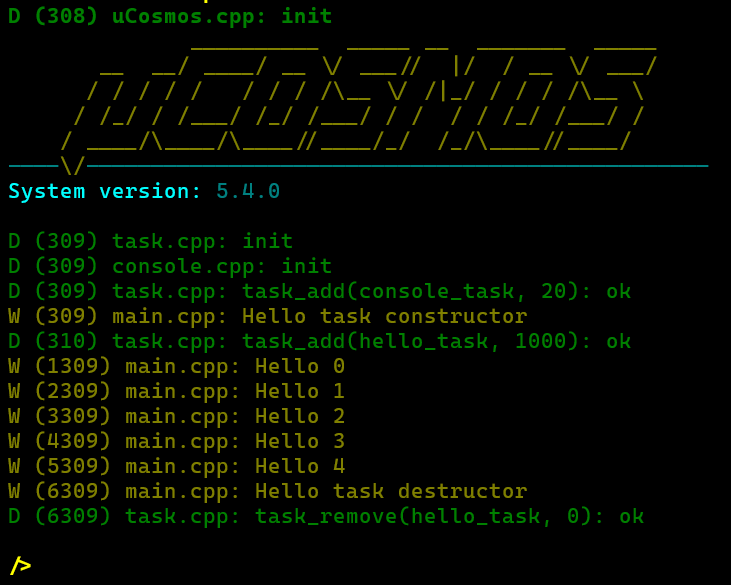
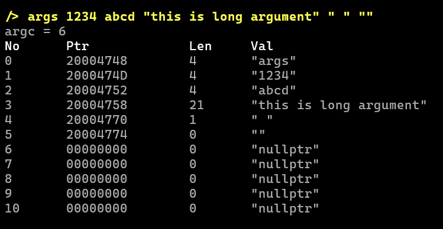
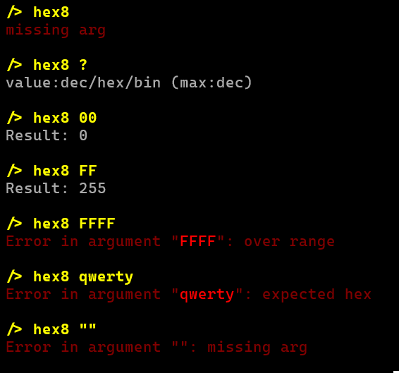
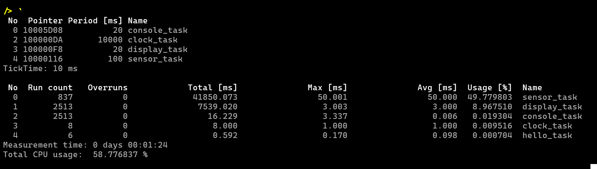
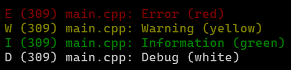
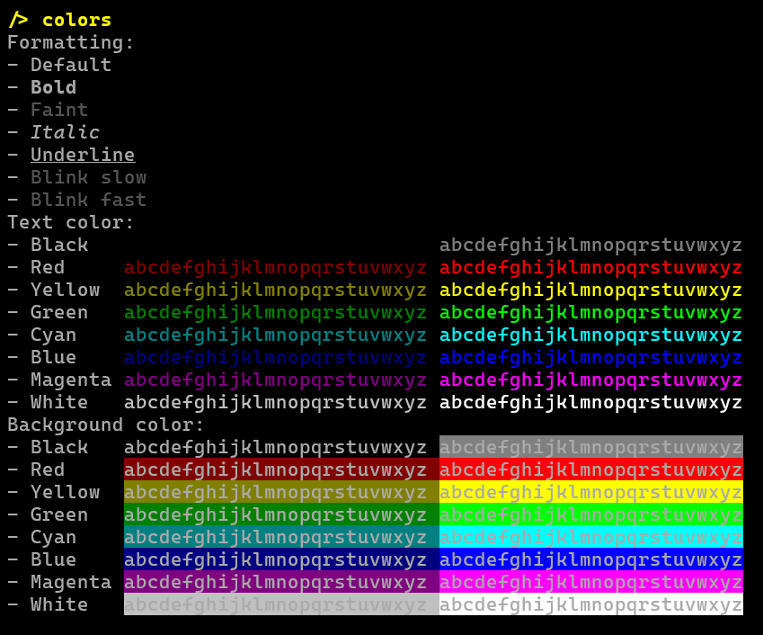

# μCOSMOS

What is uCosmos?
* **μC** - Microcontroller
* **OS** - Operating System
* **MOS** - Metal Oxide Semiconductor (yeah, that's dumb...)

This is a simple, single-threaded, single-core lightweight cooperative scheduler and command-line interpreter designed for microcontrollers. It currently supports microcontrollers such as the Espressif ESP32, as well as the Raspberry Pi RP2040, RP2350, and RP2354; however, adding support for other devices is very straightforward. All that is required is a single timer that triggers an interrupt at regular intervals and an input stream for keyboard data, such as a UART or USB interface.

## Features

- Cooperative, non-preemptive scheduler driven by a single hardware timer.
- Periodic tasks with configurable periods.
- Full task lifecycle supported: constructor, destructor, run and identification.
- A built-in command-line interpreter that generates standard `argc` and `argv` data.
- CTRL-Z to recall the last command.
- Rich, type-safe set of argument parsers for 8/16/32/64-bit signed integers, 8/16/32/64-bit unsigned integers, float/double values, ASCII characters, ASCII strings, HEX strings and timestamps.
- Optional diagnostic subsystem measuring task execution time, overruns, total execution time and total CPU usage.
- Portable and compact code: the hardware abstraction layer consists of a handful of macros, so porting to a new MCU is very easy.

## Why use uCosmos?

uCosmos is designed for small and medium embedded projects where
predictability, simplicity and low resource usage are more important
than true multitasking.

Advantages:

- No context switching overhead.
- No per-task stacks, resulting in very low RAM consumption.
- Deterministic execution model based on periodic tasks.
- Easier debugging because all code executes within a single thread.
- Integrated command-line interface for diagnostics and testing.
- Built-in task monitoring and CPU usage analysis.
- Powerful command line interpreter to facilitate testing and development.
- Simple component-based architecture allowing code reuse across many products.
- Easy portability to new MCUs through a very small hardware abstraction layer.

uCosmos may be a better choice than a traditional RTOS when:

- Tasks are short and periodic,
- RAM resources are limited,
- Debugging simplicity is important,
- The application does not require preemption or blocking APIs.

## Table of contents

- [Supported platforms](#supported-platforms)
- [Hello World!](#hello-world)
- [Architecture overview](#architecture-overview)
  - [Folder tree](#folder-tree)
  - [Cloning the repository](#cloning-the-repository)
  - [Main config](#main-config)
  - [Startup](#startup)
  - [Component config](#component-config)
- [Task management](#task-management)
  - [Task template](#task-template)
  - [Adding a task](#adding-a-task)
  - [Removing a task](#removing-a-task)
  - [Changing a task period](#changing-a-task-period)
  - [Checking whether a task is added](#checking-whether-a-task-is-added)
  - [Getting the task name](#getting-the-task-name)
- [Command line](#command-line)
  - [Command line basics](#command-line-basics)
  - [Command list](#command-list)
  - [Creating custom commands](#creating-custom-commands)
  - [Command help](#command-help)
  - [Argument parsers](#argument-parsers)
    - [Unsigned integer](#unsigned-integer)
    - [Signed integer](#signed-integer)
    - [Floating point](#floating-point)
    - [ASCII character](#ascii-character)
    - [ASCII string](#ascii-string)
    - [HEX string](#hex-string)
    - [Time](#time)
- [Diagnostic tools](#diagnostic-tools)
    - [Task monitor](#task-monitor)
	- [Time measurement](#time-measurement)
- [Logs](#logs)
  - [Formatting and colors](#formatting-and-colors)
- [Change log](#change-log)

## Supported platforms

| Platform                 | Toolchain |
|--------------------------|-----------|
| Espressif ESP32          | ESP-IDF   |
| Raspberry Pi Pico RP2xxx | Pico SDK  |

# Hello World!

Here is an example of a very simple program. It demonstrates system initialization and the starting of the scheduler. Between these steps, we add a single task configured to be executed every 1000 ms. The task displays a greeting when it is created (within its constructor), then five greetings during its regular execution, and a final greeting when it is removed (within its destructor).

```c++
#include "_config/_config.h"
#include "uCosmos/uCosmos.h"

void hello_task(run_mode_t run_mode) {
    static int counter = 0;
    
    if(run_mode == os_run) {
        if(counter < 5) {
            LOGW("Hello %d", counter++);
        }
        else {
            task_remove(hello_task);
        }
    }
    else if(run_mode == os_constructor) {
        LOGW("Hello from the task constructor");
        counter = 0;
    }
    else if(run_mode == os_destructor) {
        LOGW("Hello from the task destructor");
    }
    else if(run_mode == os_id) {
        task_name = __func__;
    }
}

int main() {
    uCosmos_init();
    task_add(hello_task, 1000);
    uCosmos_scheduler();
}
```

The constructor is executed immediately after task_add(), then the task runs five times at one-second intervals and finally removes itself, invoking its destructor. Here is the screenshot of the result:



# Architecture overview

The uCosmos system was created to facilitate the management of multiple tasks - not just within a single project, but across many. It was designed with the goal of allowing code written once to be reused in various products and other projects. In the example below, we will look at a simple project where the code repository is set up for two products: a *premium* version that includes a display, a clock, and EEPROM memory, and a *basic* version that features only a clock and EEPROM memory, but lacks a display.

## Folder tree

This is how the project tree should look. The repository consists of four components: `uCosmos`, `clock`, `eeprom`, and `lcd_display`. Each component has its own folder, which stores the **shared** code used across all products. Each component can be set up as a separate submodule with its own repository, allowing the code to be shared among different projects. Furthermore, each component can be adjusted to the specific requirements of your project through configuration files; these are stored in a `_config` folder and belong to your project's repository, rather than to the submodules themselves.

```
your_project
│   .gitignore
│   .gitmodules
│   main.cpp
│
├── _config                        - Folder for all configuration files, stored in your repo
│       _commands.h                - Command list
│       _config.h                  - General config for all your products and components included for each product
│       eeprom_config.h            - Config file for EEPROM component
│       lcd_display_config.h       - Config file for LCD Display component
│       uCosmos_config.h           - Config file for uCosmos component
│
├── clock                          - Example of a very simple component: no config file, no commands
│       clock.cpp
│       clock.h
│
├── eeprom                         - Example of a more advanced component: config file present and a command list
│   │   eeprom.cpp
│   │   eeprom.h
│   │   eeprom.hxx                 - File with command list used in this component to be included in `_config/_commands.h`
│   │
│   └── template
│           eeprom_config.h        - Copy this file to `_config` folder
│
├── lcd_display                    - Example of a component where all the commands are placed in separate files
│   │   lcd_display.cpp
│   │   lcd_display.h
│   │   lcd_display_demo.cpp       - Commands for testing and debug only
│   │   lcd_display_demo.h
│   │   lcd_display_demo.hxx       - File with command list used in this component to be included in `_config/_commands.h`
│   │
│   └── template
│           lcd_display_config.h   - Copy this file to `_config` folder
│
└── uCosmos                        - This repo (cloned as a submodule)
    │   commands.cpp
    │   commands.h
    │   commands.hxx
    │   console.cpp
    │   console.h
    │   log.h
    │   readme.md                  - You are reading this file
    │   task.cpp
    │   task.h
    │   uCosmos.cpp
    │   uCosmos.h
    │
    └── template
            uCosmos_config.h       - Copy this file to `_config` folder
            uCosmos_template.h
            _commands.h            - Copy this file to `_config` folder
```

## Cloning the repository

uCosmos is designed to work as a submodule within an existing GIT repository. Navigate to the folder containing your repository-or create a new one-and then clone uCosmos as a submodule using the following command:

```bash
git submodule add git@github.com:leonow32/uCosmos.git uCosmos
git submodule update --init --recursive
```

## Main config

Let’s examine the contents of the `_config/_config.h` file. It contains the general configuration for all products that can be compiled using the code in this repository. We can see two products defined here, represented by `PRODUCT_BASIC` and `PRODUCT_PREMIUM`. Each product consists of several components, which are included via `define COMPONENT_XXX` directives; a value greater than 0 indicates that a component is present (and this value may represent the component's version number, if the component supports it). The absence of a definition, or a setting of `define COMPONENT_XXX 0`, means that the specified component should not be included in the given product.

```c++
// File _config/_config.h
#define PRODUCT_BASIC               0
#define PRODUCT_PREMIUM             1  // This will be built

#if PRODUCT_BASIC
    #define COMPONENT_CLOCK         1
    #define COMPONENT_EEPROM        1

#endif

#if PRODUCT_PREMIUM
    #define COMPONENT_CLOCK         1
    #define COMPONENT_EEPROM        1
    #define COMPONENT_LCD_DISPLAY   1   // Please note this component is not present in PRODUCT_BASIC
#endif
```

## Startup

Below is an example of a `main.cpp` file. At the very beginning, there are `#include` directives for various components; however, these are wrapped in `#if COMPONENT_XXX` preprocessor directives to ensure that only the components specified in the main configuration file-located at `_config/_config.h` are included.

The `main()` function can begin with the initialization of hardware peripherals (excluding those already handled by the system itself). If this is not required, you may skip this step. Next, initialize the system by calling `uCosmos_init()`. From this point on, you can add tasks to be executed by the task scheduler.

Components typically require initialization during the application's startup, after `uCosmos_init()` and before `uCosmos_scheduler()`. To achieve this, you must call the `component_init()` function for each component; as with the `#include` directives, each initialization call must be enclosed within an `#if COMPONENT_XXX` conditional block.

The task manager is launched by calling the `uCosmos_scheduler()` function. This function contains an infinite `while(true)` loop, meaning the program never exits it-unless a system shutdown request is issued. Such a scenario might occur, for example, prior to powering down the device.

```c++
// File main.cpp
#include "_config/_config.h"
#include "uCosmos/uCosmos.h"

#if COMPONENT_CLOCK
    #include "clock/clock.h"
#endif

#if COMPONENT_EEPROM
    #include "eeprom/eeprom.h"
#endif

#if COMPONENT_LCD_DISPLAY
    #include "lcd_display/lcd_display.h"
#endif

int main() {
    // Hardware init here
    // ...

    // Initialize the system before any tasks are added
    uCosmos_init();

    #if COMPONENT_CLOCK
        clock_init();
    #endif

    #if COMPONENT_EEPROM
        eeprom_init();
    #endif

    #if COMPONENT_LCD_DISPLAY
        lcd_display_init();
    #endif

    // Infinite loop is here
    uCosmos_scheduler();

    // Return from uCosmos_scheduler is possible to power down the product
    LOGW("End of main()");
}

```

## Component config

Let’s look at how component configuration files work, using the `clock` component as an example. Once you have downloaded the component submodule, you must copy its configuration template from `component/template/component_config.h` to `_config/component_config.h`.

Next, copy the default configuration as many times as you have products; for instance, the example below shows two configurations - one for `PRODUCT_BASIC` and one for `PRODUCT_PREMIUM`. If several products share an identical configuration, you can group them using the `||` operator, like this: `PRODUCT_BASIC || PRODUCT_PREMIUM`. In our example, the configuration for these two products differs slightly.

Note two important details. At the end of the configuration for each product, we define `#define CLOCK_CONFIG_DONE`. This helps identify errors that might occur if you add a new product to the main configuration but forget to include a specific component. In such a case, the compilation process will trigger an `#error "Missing config"` rather than a flood of messages reporting that certain variables could not be found. Secondly, there is `#define CLOCK_CONFIG_VERSION 261116`, which records the date the configuration template was last updated, in `YYMMDD` format. Keep in mind that the component code resides in the submodule, while the configuration file belongs to your own repository. If you update the submodule, the new version may include configuration changes that you will need to transfer from the template to your file in the `_config` folder. If it turns out that a component submodule requires an update to its configuration file, you will receive the following message: `#error "The version of the configuration file stored in the repository is not supported.. Please copy clock/template/clock_config.h to your _config folder"`.

```c++
// File _config/clock_config.h
#ifndef CLOCK_CONFIG_H_
#define CLOCK_CONFIG_H_

#define CLOCK_CONFIG_VERSION            261116

#if PRODUCT_BASIC
    #define CLOCK_GPIO					10
    #define CLOCK_FREQUENCY				32768
    #define CLOCK_USE_DEMO_COMMANDS     true
    #define CLOCK_CONFIG_DONE
#endif

#if PRODUCT_PREMIUM
    #define CLOCK_GPIO					11
    #define CLOCK_FREQUENCY				32768
    #define CLOCK_USE_DEMO_COMMANDS     false
    #define CLOCK_CONFIG_DONE
#endif

// ========================================
// Error handling
// ========================================

#ifndef CLOCK_CONFIG_DONE
    #error "Missing config"
#endif

#endif /* CLOCK_CONFIG_H_ */
```

# Task management

A task is, in essence, a C++ function written in a specific way. This function is invoked by the system scheduler at a configured period (or, more precisely, no more frequently than at a configured period) and continues to run until it completes its execution and returns via `return` instruction. There are no mechanisms for task preemption, nor are there separate stacks for each task-unlike in FreeRTOS. This solution is simple and effective, but it is important to note that **if a single task hangs, the entire system will hang**.

A task function always returns `void` and accepts a single argument, `run_mode`, which defines the mode in which the task is called. Possible values ​​include:
- `os_run` – a standard, periodic execution.
- `os_constructor` – the task constructor, called immediately after the task is added to the scheduler’s task array.
- `os_destructor` – the task destructor, called after the task is removed from the scheduler’s task array.
- `os_id` – an identification call, used solely to retrieve the task's name for diagnostic purposes.

There is an important detail regarding the task destructor when a task removes itself. In such a case, the task is invoked by the scheduler with the `os_run` argument. To initiate its own removal, the task calls the `task_remove()` function, passing itself as an argument. `task_remove()` then triggers the task's destructor; however, once the destructor finishes, execution returns to the main body of the task function. This means that a task that has initiated its own removal continues to execute for a short period until it reaches its own `return` statement. Therefore, **it is good practice for the removal of a task to be the last instruction that the task executes, immediately followed by a `return` statement**.

## Task template

Below are two task templates that are equivalent; the choice between them depends solely on your preference. One uses a `switch-case` statement, while the other uses `if-else`.

Each task must support being called with the arguments `os_run` and `os_id`. Identification is performed by assigning the task name in the form of a C-string to the global variable `const char * task_name`. It is important that this string must remain in memory after the task function has returned. Therefore, it is best to store it in Flash memory and not to use RAM for this purpose. The `__func__` identifier is useful here, as it automatically inserts the name of the function in which it is used. Handling the `os_constructor` and `os_destructor` arguments is optional. If your task needs to store variables between calls, it is good practice to define them as static variables at the beginning of the task.

```c++
void template_task(run_mode_t run_mode) {
    // Declare static variables here

    switch(run_mode) {
        case os_run: {						// Mandatory

            break;
        }

        case os_constructor: {				// Optional

            break;
        }

        case os_destructor: {				// Optional

            break;
        }

        case os_id: {						// Mandatory
            task_name = __func__;			// Do not change this line
            break;
        }
    }
}
```

```c++
void template_task(run_mode_t run_mode) {
    // Declare static variables here

    if(run_mode == os_run) {				// Mandatory

    }
    else if(run_mode == os_constructor) {	// Optional

    }
    else if(run_mode == os_destructor) {	// Optional

    }
    else if(run_mode == os_id) {			// Mandatory
        task_name = __func__;				// Do not change this line
    }
}
```

## Adding a task

To add a task to the scheduler's task table, call the function `os_t task_add(void (*task_ptr)(run_mode_t), uint16_t period_ms)`, where `task_ptr` is a pointer to the task and `period_ms` is the task's requested execution period given in milliseconds. After adding the task, it is called with the `os_constructor` argument. The constructor is called immediately and synchronously from `task_add()`.

Examples:

```c++
task_add(some_task, 1000);
task_add(other_task, 500);
task_add(another_task, 200);
```

This function can return one of the following values:

- `os_ok` – success.
- `os_nullptr` – the `task_ptr` argument is `nullptr`.
- `os_task_period_under_range` – the task was not added because its execution period is shorter than the system tick period, defined by the `TICK_PERIOD_MS` parameter in the configuration file.
- `os_task_already_created` – the specified task has already been added; duplicate tasks cannot be added.
- `os_no_free_slot` – no space available in the task array; consider increasing the `TASK_MAXCOUNT` parameter in the configuration file.
- `os_period_rounded` – the task was added, but since the requested period is not a multiple of `TICK_PERIOD_MS`, the period has been rounded.

## Removing a task

To remove a task from the scheduler's task array, use the function `os_t task_remove(void (*task_ptr)(run_mode_t))`, where `task_ptr` is a pointer to the task.

Examples:

```c++
task_remove(some_task);
task_remove(other_task);
task_remove(another_task);
```

This function can return one of the following values:

- `os_ok` – success.
- `os_nullptr` – the `task_ptr` argument is `nullptr`.
- `os_not_found` - the specified task is not present in the scheduler's task array.

## Changing a task period

To change the execution period of a task, call the function `os_t task_period_change(void (*task_ptr)(run_mode_t), uint16_t period_ms)`, where `task_ptr` is a pointer to the task and `period_ms` is the task's execution period given in milliseconds.

Examples:

```c++
task_period_change(some_task, 1234);
task_period_change(other_task, 5678);
task_period_change(another_task, 31415);
```

This function can return one of the following values:

- `os_ok` – success.
- `os_nullptr` – the `task_ptr` argument is `nullptr`.
- `os_not_found` - the specified task is not present in the scheduler's task array.
- `os_task_period_under_range` – operation not possible because its execution period is shorter than the system tick period, defined by the `TICK_PERIOD_MS` parameter in the configuration file.
- `os_period_rounded` – the period has been changed, but since the requested period is not a multiple of `TICK_PERIOD_MS`, the period has been rounded.

## Checking whether a task is added

To check whether a task has been added to the scheduler's task array, use the function `bool task_is_running(void (*task_ptr)(run_mode_t))`. Important: this function does not check whether the specified task is currently being executed; rather, it checks whether the task is scheduled for execution within the schedule.

Example:

```c++
if(task_is_running(my_task)) {
    LOGI("The task has been added");
}
else {
    LOGI("The task has been removed");
}
```

This function can return one of the following values:

- `true`
- `false`

## Getting the task name

To get the task name, use the const char * task_get_name(void (*task_ptr)(run_mode_t)) function. This function returns a pointer to a C-string containing the task's name. If the task does not support identification, the function returns the string `"unknown"`; if it is called with a null pointer, it returns `"nullptr"`.

Example

```c++
printf("My task is called %s.\n", task_get_name(my_task));
```

# Command line

uCosmos features a console with a command-line interpreter that allows you to execute custom-defined commands and pass various types of arguments to them. This console is extremely useful for testing and diagnostics, as it provides access to data and operations that are not typically available to the end user. The command line uses the same UART interface that is used for logging, the one assigned to the standard input and output streams.

It is important to understand that the console in the uCosmos is a task, just like any other. All rules that apply to tasks also apply to the console task. Every command invoked by the console is executed within the context of the console's own execution, as managed by the scheduler. In other words: the scheduler executes the console, the console executes a command, and the command may execute argument parsers.

## Command line basics

During normal operation, the command prompt is hidden to ensure that the potentially large volume of logs remains readable. To bring up the prompt, simply start typing; the `/>` symbol will appear, followed by the characters you enter. If any logs appear while you are typing, do not worry-just keep typing. Everything you have typed so far remains in the buffer. You can delete the last character entered by pressing the BACKSPACE key. To clear the entire buffer and display the prompt, press the ESCAPE key. The ENTER key executes the command. The CTRL-Z key combination recalls the last entered command, which you can then edit or execute by pressing ENTER.

Your commands can accept arguments. There must be at least one SPACE between arguments. If an argument is a string of characters that contains spaces, it should be enclosed in double quotation marks. Two consecutive double quotation marks result in an argument of zero length.

You can experiment with the `args` command, which displays all the arguments that have been passed.



## Command list

In this chapter, you will learn how the command list is organized. It is defined in the file `_config/_commands.h`, which you can create by copying the template file from `uCosmos/template/_commands.h`. While the command list belongs to your repository, some commands may be imported from the internal command lists of individual components - which could themselves be submodules. At the very beginning of the file, there are `#include` directives for `console.h` which contains the entire command-line interpreter and `commands.h`, which holds a set of demonstration commands. These commands can be enabled or disabled in the configuration file `_config/uCosmos_config.h`.

In essence, the command list is an array of `command_struct` elements. Each structure consists of a command name (defined as `const char * name`) and a function pointer (defined as `void (*ptr)(int argc, char * argv[])`) that points to the function to be executed when that command name is entered. I recommend placing the command name and the function pointer on the same line, as shown in the example below. This improves code readability, which is particularly helpful given that the command list can become quite long.

In component configuration files, you will often encounter the variable `COMPONENT_USE_DEMO_COMMANDS`. This provides an easy way to enable or disable commands designed to demonstrate a component's capabilities. This is achieved using the preprocessor directive `#if CLOCK_USE_DEMO_COMMANDS`.

```c++
// File _config/_commands.h
#include "_config/_config.h"
#ifndef INTERPRETER_COMMANDS_H_
#define INTERPRETER_COMMANDS_H_

#include "uCosmos/console.h"
#include "uCosmos/commands.h"

#if COMPONENT_CLOCK
    #include "clock/clock.h"
#endif

#if COMPONENT_EEPROM
    #include "eeprom/eeprom.h"
#endif

#if COMPONENT_LCD_DISPLAY
    #include "lcd_display/lcd_display_demo.h"
#endif

const command_struct command_list[] = {
    #include "uCosmos/commands.hxx"
    #include "lcd_display/lcd_display_demo.hxx"

    #if CLOCK_USE_DEMO_COMMANDS
        {"clock_get",                   clock::get_cmd},
        {"clock_set",                   clock::set_cmd},
    #endif

    #if EEPROM_USE_DEMO_COMMANDS
        {"ee_read",                     eeprom::read_cmd},
        {"ee_write",                    eeprom::write_cmd},
        {"ee_dump",                     eeprom::dump_cmd},
        {"ee_info",                     eeprom::info_cmd},
    #endif
};

#endif
```

## Creating custom commands

The code for a simple example command is presented below. Every function that can be invoked via the command-line interpreter must accept two arguments:
- `int argc` – the number of arguments passed; this is always >= 1.
- `char * argv[]` – an array of pointers to the beginning of each argument, provided as a C-string. The value `argv[0]` is the name of the command entered by the user.

A command-handling function can perform any type of operation. Parsers are used to read argument values, and these will be discussed in subsequent chapters. Ensure that any data printed by this function ends with a newline character (`\n`). You may use the `print_ok()` function, which prints the text "OK" in green, followed by a newline.

```c++
void template_cmd(int argc, char * argv[]) {
    CMD_HELP("arg1:dec8 arg2:dec16 arg3:hex16");
    
    uint8_t arg1;
    if(parse_dec(argv[1], &arg1)) return;

    uint16_t arg2;
    if(parse_dec(argv[2], &arg2)) return;

    uint16_t arg3;
    if(parse_hex(argv[3], &arg3)) return;
    
    // do something

    print_ok();
}
```

## Command help

It is possible to add help text to each command. To do this, place the `CMD_HELP("text")` macro definition at the beginning of the function that handles the command. A newline character (`\n`) will be automatically appended to the end. The help text can also span multiple lines. Help text can consume a significant amount of flash memory. For this reason, you can quickly and easily disable the help feature by changing the `CONSOLE_USE_HELP` definition from `true` to `false` in the configuration file `_config/uCosmos_config.h`.

It is recommended that you list the argument names and, if useful, their types in the help text, as shown in the example below:

```c++
void task_period_change_cmd(int argc, char * argv[]) {
    CMD_HELP("ptr:hex32 period:dec16");
    // do something...
}

void gpio_dir_cmd(int argc, char * argv[]) {
    CMD_HELP("num:dec dir:dec(0=in, 1=out)");
    // do something...
}
```

## Argument parsers

Command-handling functions receive an argument count, `argc`, and an array of character strings, `argv[]`. The data in this array is stored as C-style strings. To convert this text into values ​​of the desired type, an appropriate parser must be used.

In this chapter, we will discuss the rules that apply to all argument parsers. Below is a general example demonstrating the use of a parser for a hypothetical data type. Every parser takes at least two arguments: the first is a pointer to a specific element in the `argv[]` array, and the second is a pointer to a variable where the parsed result should be stored. Each parser returns a value of type `parse_res`. If the parsing is successful, the parser returns `parse_ok`, which is equal to 0.

If a parsing function encounters an error, it displays an error message on the console and returns an error code. This can be used to exit the command-handling function immediately; simply wrap the parser call in an `if` statement and include a `return` statement.

```c++
xxxxx_t value;
if(parse_yyyyy(argv[1], &value)) return;
```

These are examples of messages you might see in the console in case of a parsing error.



Here is a list of all possible values ​​returned by the parsers.

- `parse_ok` - success.
- `parse_missing_argument` - argument pointer is `nullptr` or first character of the string is NUL.
- `parse_over_range` - value of the variable exceeds the maximum size, either as determined by the variable's type or by a user-specified constraint.
- `parse_under_range` - the value is below the minimum allowed value determined by the variable's type.
- `parse_error` - other error.
- `parse_expected_bin` - the input should be binary value.
- `parse_expected_dec` - the input should be decimal value.
- `parse_expected_hex` - the input should be hexadecimal value.
- `parse_expected_float` - the input should be floating point value.
- `parse_expected_char` - the input should be a single ASCII character.
- `parse_wrong_base` - base of the input number must be in the range from 2 to 16.
- `parse_wrong_time` - time value is not given in YYMMDDhhmmss format or the date/time is incorrect.
- `parse_nullptr` - output pointer is `nullptr`.

### Unsigned integer

Converts an argument that is an unsigned integer of 8, 16, 32, or 64 bits. For long numbers, the `'` character can be used as a separator. A universal parser, `parse_uint`, is available and can be used to parse numbers with various bases ranging from 2 to 16. For convenience, there are wrappers-`parse_bin`, `parse_dec`, and `parse_hex`-that specify whether the input number should be treated as binary, decimal, or hexadecimal, respectively. In every parser, you can additionally enable a maximum value check by setting the `max` argument. By default, it is set to the maximum value for a variable of the specified type.

```c++
template<typename T> parse_res parse_uint(const char * arg, T * output, uint8_t base, T max);
parse_res parse_dec(const char * arg, uint8_t  * output, uint8_t  max);
parse_res parse_dec(const char * arg, uint16_t * output, uint16_t max);
parse_res parse_dec(const char * arg, uint32_t * output, uint32_t max);
parse_res parse_dec(const char * arg, uint64_t * output, uint64_t max);

parse_res parse_hex(const char * arg, uint8_t  * output, uint8_t  max);
parse_res parse_hex(const char * arg, uint16_t * output, uint16_t max);
parse_res parse_hex(const char * arg, uint32_t * output, uint32_t max);
parse_res parse_hex(const char * arg, uint64_t * output, uint64_t max);

parse_res parse_bin(const char * arg, uint8_t  * output, uint8_t  max);
parse_res parse_bin(const char * arg, uint16_t * output, uint16_t max);
parse_res parse_bin(const char * arg, uint32_t * output, uint32_t max);
parse_res parse_bin(const char * arg, uint64_t * output, uint64_t max);
```

Example:

```c++
uint32_t value;
if(parse_dec(argv[1], &value, 1234)) return;
printf("Result: %lu", value);         
```

### Signed integer

Converts an argument that is a signed integer with a length of 8, 16, 32, or 64 bits. For long numbers, the `'` character can be used as a separator.

```c++
template<typename T> parse_res parse_int(const char * arg, T * output);
parse_res parse_int(const char * arg, int8_t * output);
parse_res parse_int(const char * arg, int16_t * output);
parse_res parse_int(const char * arg, int32_t * output);
parse_res parse_int(const char * arg, int64_t * output);
```

Example:

```c++
int16_t value;
if(parse_int(argv[1], &value)) return;
printf("%d", value);
```

### Floating point

Converts an argument that is a floating-point number of type `float` or `double`. The decimal separator can be either `.` or `,`, and the exponent character can be `e` or `E`. Examples of data that the parser can accept include: `123`, `+123`, `-123`, `123,456`, `123.456`, `123.456e78`, and `123,456E-78`. The parser supports `nan` for "not a number" special value, `inf` and `-inf` for positive and negative infinity.

```c++
template<typename T> parse_res parse_float(const char * arg, T * output);
parse_res parse_float(const char * arg, float * output);
parse_res parse_float(const char * arg, double * output);
```

Example:

```c++
float value;
if(parse_float(argv[1], &value)) return;
printf("%f", value);
```

### ASCII character

Converts an argument that is a single ASCII character into a variable of type `char`.

```c++
parse_res parse_ascii_char(const char * arg, char * output);
```

Example:

```c++
char character;
if(parse_ascii_char(argv[1], &character)) return;
printf("%c", character);
```

### ASCII string

Converts an ASCII string argument into a `char[]` array. It returns the array via the `output` pointer and the number of characters in that array via the `output_length` pointer. You must specify the size of the destination buffer using the `buffer_size` argument to ensure the function does not write more data than the buffer can hold. You may also include an optional check for the minimum length of the input data; if the provided string is shorter than `min_length`, the function will return `parse_under_range`.

```c++
parse_res parse_ascii_string(const char * arg, char * output, size_t * output_length, const size_t buffer_size, const size_t min_length = 0);
```

Example:

```c++
char buffer[16];
size_t length;
if(parse_ascii_string(argv[1], buffer, &length, sizeof(buffer), 0)) return;
printf("length: %u\n", length);
printf("buffer: %s\n", buffer);
```

### HEX string

Converts the argument, which is a HEX string (characters 0...9 and A...F or a...f), to a byte array `uint8_t[]`. The input string may contain spaces as byte separators; in such cases, the string must be enclosed in double quotation marks (e.g., `"AA BB CC DD EE FF"`). The function returns the array via the `output` pointer and the number of bytes in that array via the `output_length` pointer. You must specify the size of the destination buffer using the `buffer_size` argument to ensure the function does not write more data than the buffer can hold. An optional check for the minimum length of the input data is also available; if the provided string is shorter than `min_length`, the function will return `parse_under_range`.

```c++
parse_res parse_hex_string(const char * arg, uint8_t * output, size_t * output_length, const size_t buffer_size, const size_t min_length = 0);
```

Example:

```c++
uint8_t buffer[16];
size_t length;
if(parse_hex_string(argv[1], buffer, &length, sizeof(buffer))) return;
printf("length: %u\n", length);
printf("HEX: ");
print_hexstr(buffer, length, true, ' ');
```

### Time

Converts an argument representing a date and time in the format YYMMDDhhmmss. The parser strictly validates the ranges of all date and time components, as well as leap years.

```c++
parse_res parse_time(const char * arg, time_t * output);
```

Example:

```c++
time_t time_seconds;
if(parse_time(argv[1], &time_seconds)) return;

tm time_struct;
localtime_r(&time_seconds, &time_struct);

printf("%04u-%02u-%02u %02u:%02u:%02u\n",
    time_struct.tm_year + 1900,
    time_struct.tm_mon + 1,
    time_struct.tm_mday,
    time_struct.tm_hour,
    time_struct.tm_min,
    time_struct.tm_sec
);
```

# Diagnostic tools

The uCosmos system is equipped with many diagnostic tools that allow you to monitor the execution time of tasks and other activities as well as the processor load. Please note that these diagnostic tools consume both flash and RAM; therefore, it is advisable to disable them in the firmware for the final product.

The configuration file `_config/uCosmos_config.h` contains several variables used to configure these diagnostic tools:

- `USE_CMD_TASK_MONITOR` – when set to `true`, this enables a command `` ` `` that displays diagnostic information on the console.
- `DIAG_USE` – when set to `true`, this enables the analysis of task execution times.
- `DIAG_COUNT` – specifies the number of tasks to be included in the execution time analysis. Each task requires 32 bytes of data, so setting this value too high will result in significant RAM consumption.
- `DIAG_SORT_BEFORE_PRINT` – if set to `false`, the timing analysis is displayed in the order in which tasks were added to the scheduler (from oldest to newest). If set to `true`, the tasks are sorted by execution time, displayed from the most time-consuming to the least.

## Task monitor

The `` ` `` command displays various information on the console about tasks currently running and previously executed. Let's see an example. The screenshot below shows a scenario with four active tasks: `console_task`, `clock_task`, `display_task`, and `sensor_task`. We can see a pointer to the address in flash memory where these tasks reside (which can be useful if a product contains multiple program memory units). The table also shows the intervals at which these tasks are executed (assuming that none of them will take excessively long to execute and will not disturb the schedule).

The second table presents a time analysis of all tasks, starting from the beginning of the analysis - that is, from the moment the uCosmos system was started or the command ``` `` ``` was entered to reset the results. Time analysis shows all tasks, even if they were later removed from the scheduler. The table shows the following columns:

- `Run count` - how many times the task was executed.
- `Overruns` – the number of times a task has run longer than it should have. An overrun occurs when a task's execution time exceeds its defined period. For example, if a task is scheduled to run every 100 ms but takes 101 ms to complete, this counts as an overrun.
- `Total [ms]` - total time of all task calls expressed in milliseconds.
- `Max [ms]` - how long the longest task call took, expressed in milliseconds.
- `Avg [ms]` - average task execution time, expressed in milliseconds.
- `Usage [%]` – the percentage of total time consumed by a given task.
- `Name` – the name of the task.

Below the table, two values ​​are displayed:
- `Measurement time` – the duration over which data has been collected, expressed in days, hours, minutes, and seconds.
- `Total CPU usage` – the total amount of time the processor has spent executing tasks.



## Time measurement

To find out how much time has elapsed since the system started, use the function uint64_t get_time_us().

A more advanced way is to use the `ExecutionTimer` class, which is designed to measure the time between two events. A class starts counting time when its constructor or `.begin()` method is executed. To stop the measurement, call the `.end()` method, and retrieve the result using the `.get()` method. Alternatively, you can use the `.print(const char * text = nullptr)` method, which stops the measurement and displays the result on the console, optionally accompanied by a text message if provided. Furthermore, `.print()` displays the time in milliseconds, with microseconds shown after a decimal point, using three significant digits - a format that is both readable and convenient.

Examples:

```c++
ExecutionTimer timer1 = ExecutionTimer();
// do something
timer1.end();
uint64_t result = timer1.get();
printf("Execution timer: %llu ms\n", result / 1000);

ExecutionTimer timer2 = ExecutionTimer();
// do something
timer2.print("Execution timer");
```

Result:

```
Execution timer: 10 ms
Execution timer: 10.004 ms
```

# Logs

The uCosmos system provides a convenient library for displaying logs. There are four types of messages, distinguished by color and a prefix at the beginning of the line:

| Log  | Prefix | Color  | Purpose     |
|------|--------|--------|-------------|
|`LOGE`| E      | Red    | Error       |
|`LOGW`| W      | Yellow | Warning     |
|`LOGI`| I      | Green  | Information |
|`LOGD`| D      | White  | Debug       |

The code below presents basic examples of all four types of log messages:

```c++
LOGE("Error (red)");
LOGW("Warning (yellow)");
LOGI("Information (green)");
LOGD("Debug (white)");
```

Here is the result:



The number in parentheses represents the time in milliseconds, measured from system startup. The *.cpp filename is added automatically to make it easier to locate the source of these log entries. There is no need to add "\n", as a newline character is added automatically.

Within logs, you can display variables in exactly the same way as you would using the `printf()` function. Here are a few examples.

```c++
char character = 'a';
int  integer   = 123;
uint8_t  u8    = 255;
uint16_t u16   = 65535;
uint32_t u32   = 4294967295UL;

LOGI("character = %c", character);
LOGI("integer = %d", integer);
LOGI("u8 = %u", u8);
LOGI("u16 = %u", u16);
LOGI("u32 = %lu", u32);
```

## Formatting and colors

uCosmos provides a wide range of definitions to facilitate text formatting in accordance with the ANSI standard. Below is a list of definitions that you can use and combine to achieve various effects. Please note, however, that not all terminals support every one of them.

* Text format: `FORMAT_RESET`, `FORMAT_BOLD`, `FORMAT_FAINT`, `FORMAT_ITALIC`, `FORMAT_UNDERLINE`, `FORMAT_BLINK_SLOW`, `FORMAT_BLINK_FAST`.
* Foreground color: `TEXT_BLACK`, `TEXT_RED`, `TEXT_GREEN`, `TEXT_YELLOW`, `TEXT_BLUE`, `TEXT_MAGENTA`, `TEXT_CYAN`, `TEXT_WHITE`, `TEXT_BLACK_BRIGHT`, `TEXT_RED_BRIGHT`, `TEXT_GREEN_BRIGHT`, `TEXT_YELLOW_BRIGHT`, `TEXT_BLUE_BRIGHT`, `TEXT_MAGENTA_BRIGHT`, `TEXT_CYAN_BRIGHT`, `TEXT_WHITE_BRIGHT`.
* Background color: `BACK_BLACK`, `BACK_RED`, `BACK_GREEN`, `BACK_YELLOW`, `BACK_BLUE`, `BACK_MAGENTA`, `BACK_CYAN`, `BACK_WHITE`, `BACK_BLACK_BRIGHT`, `BACK_RED_BRIGHT`, `BACK_GREEN_BRIGHT`, `BACK_YELLOW_BRIGHT`, `BACK_BLUE_BRIGHT`, `BACK_MAGENTA_BRIGHT`, `BACK_CYAN_BRIGHT`, `BACK_WHITE_BRIGHT`.

Example:

```c++
printf("This text is " TEXT_YELLOW "yellow on " BACK_BLUE "blue background" FORMAT_RESET "\n");
printf("Now let's try " FORMAT_BOLD "bold with " FORMAT_UNDERLINE "underline" FORMAT_RESET "\n");
```

You can try the command `colors` on the console. It is available if `USE_CMD_COLORS` is set to `true`.



# Change log

The project has been under continuous development since 2011.

## 5.4.0 - 2026.11.26
* Added very long `readme.md`.
* Added `colors` command.
* Added `USE_CMD_COLORS` to config file (version 261120).
* Added `os_period_rounded` warning that appears if the period of the task being created is not a multiple of TICK_PERIOD_MS.
* Added `parse_expected_char` error code to signal that a string with a length greater than 1 has been passed to the `parse_ascii_char` parser.
* Changed `CMD_HELP()` to show help for a command when the only argument passed to the command is the `?` character.

## 5.3.0 - 2026.11.17
* Added quite advanced task diagnostics, including task time measurement, maximum and average time, overrun control, CPU usage, etc.
* Added `CMD_HELP` macro to facilitate the creation of user guides for console commands.
* Added version control of config files.
* Changed `task_close` to `task_remove` because this function in fact doesn't close the task (it may be currently running) but only removes it from `task_table` so it will not be called anymore unless it is added again.
* All comments translated to English.

## 5.2.0 - 2026.11.09
* Added float parser.
* Added `uCosmos_deinit` to shut down the system before power is cut off.
* Added `print_hexstr` function to make it easier to print arrays in HEX format.

## 5.1.0 - 2026.11.03
* Added `parse_dec()`, `parse_hex()` and `parse_bin()` for greater convenience, eliminating the need to specify the numeral base each time.
* Key `'` can be used as a digit separator in numeric parsers.
* Fixed bug in verification of the max value given to `parse_uint()`.
* Demos of argument parsers have been optimized.

## 5.0.0 - 2026.10.04
* Initial release to GitHub.
* Ported to Raspberry Pi Pico RP2040, RP2350, RP2354.

## 4.0.0 - 2024
* Ported to Espressif ESP32.

## 3.0.0 - 2018
* Redesigned the entire task management system and command interpreter to provide a robust foundation for various projects using AVR microcontrollers.

## 2.0.0 - 2013
* I developed the second version for my master's thesis, which was a system for monitoring building tilt. It consisted of a central unit that communicated with sensor modules, which in turn collected data from various inclinometers.

## 1.0.0 - 2011
* The first version was developed as part of my engineering thesis. At the time, it served as an HPGL language interpreter running on an ATmega128 microcontroller, designed to control a pen plotter.